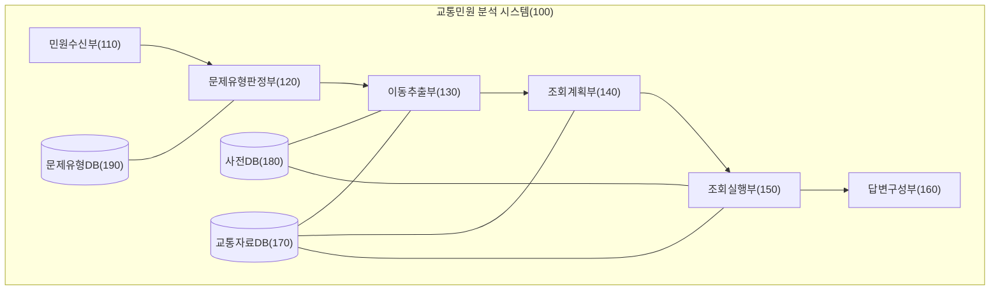
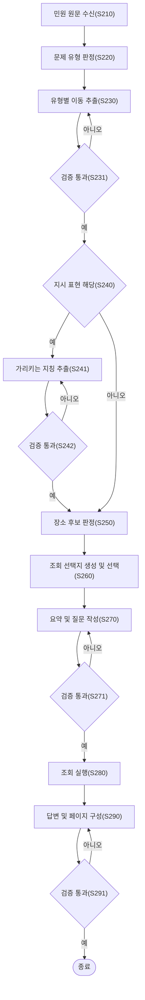

# 특허 명세서 초안

## 도 1

도 1은 본 발명의 일 실시예에 따른 교통민원 분석 시스템의 구성을 나타낸 블록도이다.

도 1을 참조하면, 교통민원 분석 시스템(100)은 민원수신부(110), 문제유형판정부(120), 이동추출부(130), 조회계획부(140), 조회실행부(150),
답변구성부(160), 교통자료DB(170), 사전DB(180) 및 문제유형DB(190)를 포함한다.

민원수신부(110)는 시민이 자유 서술로 작성한 민원 원문과 그 접수일을 수신한다. 민원수신부(110)는 노선, 정류장, 시각 등을 정해진 양식으로
입력할 것을 요구하지 않으며, 수신한 원문을 그대로 문제유형판정부(120)에 전달한다.

문제유형판정부(120)는 민원 원문에 포함된 교통 서비스 문제의 유형을 결정한다. 문제유형판정부(120)는 문제유형DB(190)에서 각 문제 유형의 명제,
그 유형에 해당하는 진술 및 인접 유형과의 경계를 읽어 유형마다 해당 여부를 묻는 판정 문항을 생성한다. 문제유형판정부(120)는 민원 원문 전체를
상태로 하여 판정 문항들을 판정 모델에 한 번에 입력하고, 판정 모델이 출력한 문항별 긍정 확률이 기준값 이상인 유형을 해당 민원의 문제 유형으로
결정한다. 유형들은 서로 독립적으로 판정되므로, 하나의 민원에 복수의 문제 유형이 결정될 수 있다. 일 실시예에서, 문제유형판정부(120)는 하위
측면을 갖는 유형이 결정되면 측면마다 판정 문항을 추가로 생성하여 측면별 해당 여부를 결정할 수 있다. 문제유형판정부(120)는 문제유형DB(190)에
기록된 조회 대상 여부에 따라, 결정된 유형 중 교통 자료로 확인할 수 없는 유형을 조회 비대상 유형으로 구분한다.

이동추출부(130)는 결정된 문제 유형마다 그 문제가 걸린 이동을 민원 원문에서 추출한다. 이동은 출발지, 도착지, 시간대, 시민이 언급한 수치 및
대상(노선, 정류장, 장소)으로 이루어지며, 각 값은 원문에 기재된 지칭과 그 지칭이 나온 원문 발췌의 쌍으로 표현된다. 이동추출부(130)는 미리 정한
출력 형식과 함께 원문과 결정된 문제 유형을 언어 모델에 입력하여 추출 결과를 받는다. 이동추출부(130)는 받은 결과가 출력 형식에 맞는지 검증하고,
결정된 유형마다 항목이 하나씩 있는지, 근거 문장·지칭·발췌가 원문에 그대로 존재하는지, 지칭이 그 발췌 안에 포함되는지를 원문과 대조하여
검증한다. 검증을 통과하지 못하면 이동추출부(130)는 어긋난 항목을 언어 모델에 되돌려 다시 작성하게 하며, 이를 검증을 통과할 때까지 정해진 횟수
안에서 반복한다. 이동추출부(130)는 추출한 지칭과 발췌가 원문에 포함되고, 지칭이 해당 발췌 안에 존재하는지를 검증한 결과를 다음 단계에 전달한다. 조회 비대상 유형에 대해서는 근거
문장만 남기고 이동을 추출하지 않는다.

또한, 이동추출부(130)는 추출된 장소 지칭이 '여기', '거기'와 같은 지시 표현이거나, '학교', '직장'과 같이 민원인을 기준으로만 특정되는 장소
표현인지 판별한다. 해당하면, 이동추출부(130)는 원문과 해당 표현 및 그 표현이 나온 문장을 언어 모델에 입력하여, 그 표현이 가리키는 장소를
원문에 기재된 지칭으로 다시 추출하게 한다. 다시 추출된 지칭 역시 원문에 그대로 존재해야 하며 그 자체가 이러한 표현이 아니어야 하고, 이를
만족하지 않으면 같은 방식으로 다시 작성하게 한다. 원문 안에서 가리키는 장소를 정할 수 없으면 해당 표현은 해석되지 않은 상태로 둔다.
이동추출부(130)는 사전DB(180)를 참조하여 지역 지칭에 해당 행정동을, 시간 표현에 해당 시간대를 대응시키고, 원문에 적힌 시각을 정규화하며,
노선 지칭에서 노선 번호를 읽어 교통자료DB(170)의 노선 이전 번호와 연결한다.

조회계획부(140)는 추출된 이동으로부터 실행할 조회를 정한다. 먼저, 조회계획부(140)는 민원의 접수일에 유효한 교통 자료의 판을 선택하고,
장소 지칭(해석된 표현의 경우 그것이 가리키는 지칭)마다 교통자료DB(170)에서 장소 후보를 검색한다. 조회계획부(140)는 장소 후보마다 정류장
이름과 좌표를 담은 판정 문항을 생성하여 판정 모델에 입력하고, 긍정 확률이 경계 구간에 있는 후보에 대해서만 행정동을 추가한 판정 문항으로 다시
판정하며, 최종 긍정 확률이 기준값 미만인 후보를 제외한다. 지역 지칭에 대해서는 해당 행정동의 정류장 전체를 지역 후보로 둔다.

이어서, 조회계획부(140)는 문제의 이동마다 그 이동의 노선, 장소 후보 및 시간대로 실행 가능한 조회를 조건까지 정한 조회 선택지로 생성한다.
조회 방법은 정류장 출발, 노선 출발, 여정, 구간 소요 및 노선 경로를 포함할 수 있으며, 조건이 동일한 조회는 하나의 선택지로 병합된다.
조회계획부(140)는 선택지마다 조회가 반환하는 값, 조회가 쓰이는 경우, 조건 및 관련 문제 유형의 명제를 담은 판정 문항을 생성하여 판정 모델에
입력하고, 긍정 확률이 기준값 이상인 선택지를 실행할 조회로 선택한다. 시간대만 다른 동일한 조회는 넓은 시간대의 조회 하나로 병합될 수 있다.
즉, 언어 모델이 도구를 직접 호출하여 조회를 구성하는 대신, 조회의 종류와 조건은 조회계획부(140)가 선택지로 생성하고 판정 모델은 그중 실행할
것을 선택한다.

마지막으로, 조회계획부(140)는 원문, 문제 유형, 이동 및 선택된 조회를 언어 모델에 입력하여, 행정 검토자가 읽을 민원 요약과, 선택된 조회마다
검토자가 자료에서 확인할 질문, 답한 것으로 볼 결과 및 개편 전후 비교 여부를 작성하게 한다. 조회계획부(140)는 선택된 조회마다 항목이 정확히
하나씩 작성되었는지와 시간대 범위의 형식을 검증하고, 어긋나면 다시 작성하게 하는 과정을 검증을 통과할 때까지 반복한다. 언어 모델은 조회를
추가하거나 삭제하지 않는다.

조회실행부(150)는 모델을 호출하지 않고, 조회계획부(140)가 정한 조회를 그 조건 그대로 교통자료DB(170)에 대하여 실행한다. 개편 전후 비교가
지정된 조회는 각 자료 판에 대하여 실행되며, 이전 자료 판에서는 해당 판에 수록된 이전 노선 번호로 조회된다. 조회실행부(150)는 각 조회 결과에
조회 입력, 결과, 자료 판 및 자료 버전으로부터 산출한 근거 식별자를 부여하고, 조회 결과로부터 정리한 파생 값에도 그 출처 근거 식별자를 남긴
근거 식별자를 부여한다. 일 실시예에서, 조회실행부(150)는 사전DB(180)의 공휴일 정보를 참조하여 질문이 묻는 요일 종류와 자료 판의 관측일이
일치하는지를 함께 기록할 수 있다.

답변구성부(160)는 조회 결과로부터 검토 화면을 구성한다. 답변구성부(160)는 조회 방법마다 정해진 형태로 표, 지도, 시간축, 막대 등의 표시 블록
후보를 생성하며, 블록의 값은 근거에서 그대로 옮기고 출처 근거 식별자를 붙인다. 답변구성부(160)는 질문, 조회 결과 및 블록 후보를 언어 모델에
입력하여 질문마다 답변을 작성하고, 함께 보일 질문과 블록 및 그 순서로 이루어진 페이지를 구성하게 한다. 답변구성부(160)는 모든 질문에 답변이
하나씩 있는지, 답변 속 조회 자료에서 가져온 수치가 해당 질문의 근거 경로를 가리키고 그 값과 일치하는지, 페이지의 블록이 해당 질문의 블록 후보인지를 검증하며,
어긋나면 다시 작성하게 하는 과정을 검증을 통과할 때까지 반복한다. 조회 자료에서 가져온 수치는 해당 조회의 근거 경로로 추적한다. 질문의 기준으로 인용한 시민의 수치는 민원 원문을 출처로 삼는다.

교통자료DB(170)는 정류장, 운행, 운행별 정류장 방문 순서와 시각, 장소, 보행 연결, 자료 판 및 노선 이전 번호를 저장한다. 사전DB(180)는 지역
지칭과 행정동의 대응, 시간 표현과 시간대의 대응 및 공휴일 정보를 저장한다. 문제유형DB(190)는 문제 유형마다 명제, 해당하는 진술, 인접 유형과의
경계, 조회 대상 여부 및 하위 측면을 저장한다.

## 도 2

도 2는 본 발명의 일 실시예에 따른 교통민원 분석 방법을 나타낸 순서도이다.

도 2를 참조하면, S210 단계에서 민원수신부(110)는 민원 원문과 그 접수일을 수신한다.

S220 단계에서 문제유형판정부(120)는 문제유형DB(190)를 참조하여 유형마다 판정 문항을 생성하고, 민원 원문 전체를 상태로 하여 판정 모델에
입력한 뒤, 긍정 확률이 기준값 이상인 유형을 해당 민원의 문제 유형으로 결정한다. 이 단계에서 조회 비대상 유형이 구분된다.

S230 단계에서 이동추출부(130)는 결정된 문제 유형마다 이동을 원문에 기재된 지칭과 그 발췌로 추출한다. S231 단계에서 이동추출부(130)는 추출
결과의 형식과, 근거 문장·지칭·발췌가 원문에 그대로 존재하는지를 검증하며, 검증을 통과하지 못하면 어긋난 항목을 되돌려 S230 단계를 다시
수행한다.

S240 단계에서 이동추출부(130)는 추출된 장소 지칭이 지시 표현이거나 민원인을 기준으로만 특정되는 장소 표현인지 판별한다. 해당하면, S241
단계에서 그 표현이 가리키는 장소를 원문에 기재된 지칭으로 다시 추출하고, S242 단계에서 다시 추출된 지칭이 원문에 그대로 존재하며 그 자체가
이러한 표현이 아닌지 검증한다. 검증을 통과하지 못하면 S241 단계를 다시 수행한다. 원문 안에서 가리키는 장소를 정할 수 없으면 해당 표현을
해석하지 않은 채 S250 단계로 진행한다.

S250 단계에서 조회계획부(140)는 접수일에 유효한 자료 판에서 장소 지칭마다 장소 후보를 검색하고, 판정 모델로 후보마다 그 지칭이 가리킬 수
있는 장소인지 판정하여 기준값 미만인 후보를 제외한다.

S260 단계에서 조회계획부(140)는 이동마다 노선, 장소 후보 및 시간대로 실행 가능한 조회를 조건까지 정한 선택지로 생성하고, 판정 모델로
선택지마다 실행 여부를 판정하여 실행할 조회를 선택한다.

S270 단계에서 조회계획부(140)는 언어 모델로 민원 요약과, 선택된 조회마다 질문, 답한 것으로 볼 결과 및 개편 전후 비교 여부를 작성한다.
S271 단계에서 선택된 조회마다 항목이 정확히 하나씩 작성되었는지 검증하며, 검증을 통과하지 못하면 S270 단계를 다시 수행한다.

S280 단계에서 조회실행부(150)는 모델을 호출하지 않고 선택된 조회를 그 조건 그대로 교통자료DB(170)에 대하여 실행하고, 조회 결과마다 근거
식별자를 부여한다.

S290 단계에서 답변구성부(160)는 조회 결과로부터 표시 블록 후보를 생성하고, 언어 모델로 질문마다 답변을 작성하며 페이지를 구성한다. S291
단계에서 답변 속 수치 표현이 해당 질문의 근거와 일치하는지와 페이지의 블록이 해당 질문의 블록 후보인지를 검증하며, 검증을 통과하지 못하면
S290 단계를 다시 수행한다. 검증을 통과하면 검토 화면을 출력하고 종료한다.

각 검증 단계의 다시 수행은 정해진 횟수 안에서 이루어진다.
