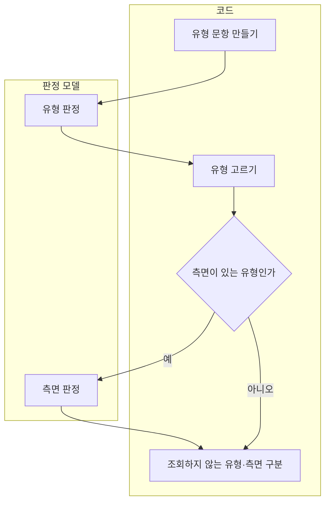
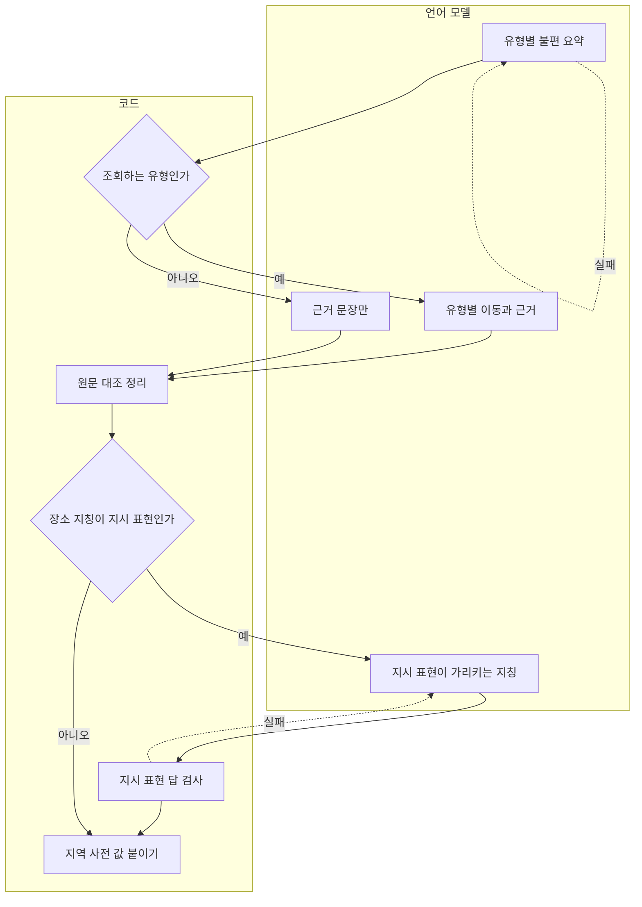
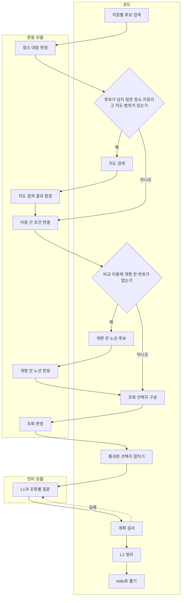
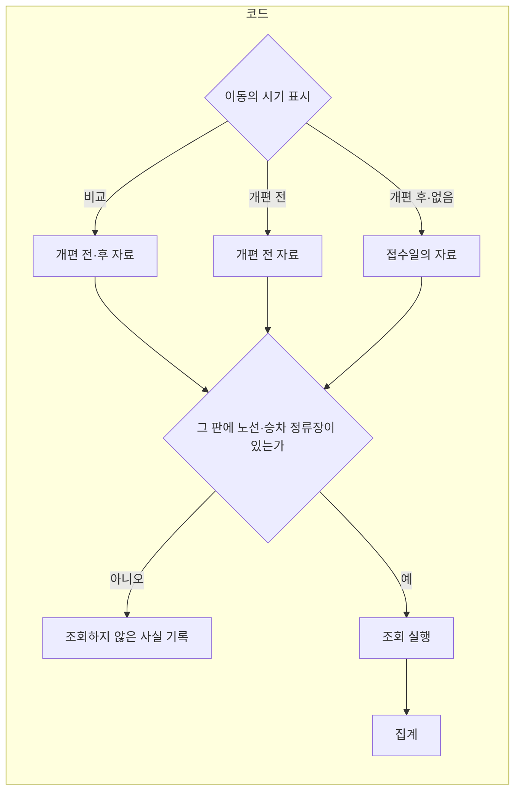
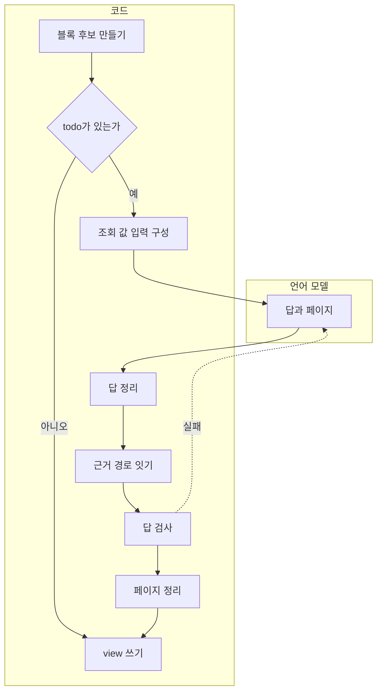

# 들리오의 구조

## 표현 수준

- **원문**: 시민이 쓴 전체 글이다. 모든 판정과 생성의 근거다.
- **L2**: 여러 민원에 공통으로 적용되는 교통 문제 유형이다. 유형의 정의와 경계는 [L2 catalog](L2_CATALOG.md)에 둔다. 한 민원에 여러 유형이 함께 있을 수 있다.
- **이동**: 유형마다 원문이 말한 출발지·도착지, 시간대, 시민이 말한 수치, 대상(노선·정류장·장소)이다.
- **L1**: 행정 검토자가 읽는 요약(한줄요약, 상황, 요청, 문의)이다. 선택한 L2와 추출한 이동을 기반으로 작성한다.

민원 읽기는 추상에서 구체로 진행한다. L2를 먼저 정하고, 이동과 L1은 그 L2를 기반으로 쓴다. 개념별 이름은 [CODEBASE_GLOSSARY](CODEBASE_GLOSSARY.md)를 따른다.

## 단계와 담당

| 단계 | 담당 | 출력 |
|---|---|---|
| `problems` | 판정 모델이 유형과 측면을 판정 | `l2` |
| `extract` | 언어 모델이 유형별 사정과 이동의 지칭을 쓰고, 코드가 원문과 대조해 정리하며, 언어 모델이 지시 표현을 풀고 코드가 prior를 붙임 | `extract` |
| `plan` | 코드가 후보와 조회 선택지를 만들고, 판정 모델이 장소 후보, 이동에 빠진 시간대·노선, 실행할 조회를 고르며, 언어 모델이 L1과 질문을 씀 | `candidates`, `plan` |
| `execute` | 코드가 조회를 실행 | `execute` |
| `compose` | 코드가 블록 후보를 만들고, 언어 모델이 답과 페이지를 씀 | `compose`, `view` |

모델이 고르는 일과 쓰는 일을 나눈다. 판정 모델은 코드가 만든 예/아니오 문항에 확률로 답하고, 코드는 기준값 0.5로 고른다.
언어 모델은 지정된 출력 schema에 맞춰 생성한다. 코드가 결과를 검증하고, 실패하면 검증 이유를 포함해 재작성을 요청한다.
판정은 `d3-ultra`의 판정 출력이 맡고, 쓰기는 Raon-1-mini-preview가 맡는다. 두 모델은 서로 다른 프로세스에서 돈다.
코드는 조회의 종류와 조건을 선택지로 구성한다. 판정 모델은 실행할 선택지를 고르고, 조회 실행 단계가 해당 조건으로 도구를 호출한다.
단계별 설계는 [ANALYSIS_STAGES](ANALYSIS_STAGES.md), 호출 방식은 [MODEL_RUNTIME](MODEL_RUNTIME.md), 이름은 [CODEBASE_GLOSSARY](CODEBASE_GLOSSARY.md)를 따른다.

## 흐름

단계마다 코드, 판정 모델, 언어 모델이 맡는 일을 lane으로 나눈다. 마름모는 분기이고, 점선은 검사에 걸려 언어 모델에 다시 쓰게 하는 경로다. 노드가 하는 일의 조건은 [ANALYSIS_STAGES](ANALYSIS_STAGES.md)를 따른다.

### 문제 유형 판정

### 문제별 추출

### 후보 준비와 계획

### 조회 실행

### 답과 화면 구성

## 원칙

- 원문에 없는 요구·조건·시간대·방향을 더하지 않는다. 모델이 쓴 지칭과 근거 문장은 원문에 그대로 있어야 하고, 지칭의 발췌 문장은 코드가 원문에서 찾는다.
- 민원 번호로 분석 목적·대상·조회·결과 문장을 정하지 않는다. 민원 번호는 입력과 실행의 식별자다.
- 지역 사전, 노선 이전 번호와 지시 표현 해석으로 원문의 지칭을 후보에 연결하고 판정 결과로 조회 대상을 선택한다. 연결할 후보를 정하지 못한 지칭은 조회 조건에서 제외한다. 출발지·도착지는 원문에 근거한 지칭으로 구성한다.
- 교통 자료로 볼 수 없는 문제(안내 정보, 환승 규칙)는 조회하지 않고 유형과 L1에만 남긴다. 조회가 없는 민원은 정상 결과다.
- 혼잡 민원은 해당 노선·시간대의 운행 현황을 조회한다. 답변의 대상은 조회로 확인한 운행 횟수·간격·시각이다.
- 답변은 질문의 대상·조건에 해당하는 운행 자료를 기술한다. 민원 진술은 조회 대상과 조건을 정하는 입력으로 사용한다.
- 검토 화면은 답변이 있는 질문과 그 근거를 표시한다. 답변하지 못한 질문과 조회 제외 사유는 실행 기록에 저장한다.

## 코드 경로

| 경로 | 역할 |
|---|---|
| [`backend/cmd/dllio`](../backend/cmd/dllio/main.go) | 단계 명령 |
| [`backend/problems`](../backend/problems/problems.go) | 유형·측면 판정 |
| [`backend/extract`](../backend/extract/extract.go) | 유형별 사정과 이동 추출, 원문 대조, 지시 표현 풀기, prior |
| [`backend/plan`](../backend/plan/plan.go) | 후보 준비, 장소 판정, 조회 선택지와 판정, 계획 |
| [`backend/execute`](../backend/execute/execute.go) | 조회 실행 |
| [`backend/compose`](../backend/compose/compose.go) | 블록 후보, 답 검사, 뷰어 입력 |
| [`backend/matchi`](../backend/matchi/writer.go) | 판정·생성 호출, 출력 형식, 검사, 호출 기록 |
| [`backend/worker`](../backend/worker/worker.go) | 판정 worker. d3-ultra로 판정을 받는 Python 프로세스를 띄우고 요청을 주고받는다 |
| [`raon`](../raon/serve.py) | Raon 생성 서버. Raon-1-mini-preview를 AMD 장치에서 띄우고 생성 요청을 받는다 |
| [`kernels`](../kernels/int4_linear.hip), `tools/build_kernels.sh` | ROCm에서 int4 층을 packed 가중치로 바로 곱하는 장치 kernel |
| [`backend/tools`](../backend/tools/tools.go) | 교통 조회 도구(SQL, 여정, 노선 경로, 구간 소요, 장소 검색) |
| `backend/journey`, `segments`, `places`, `revisions`, `store`, `sqltool` | 교통 계산과 자료 읽기 |
| [`backend/calendar`](../backend/calendar/calendar.go) | 요일·공휴일, 원문의 요일 표현 |
| `backend/jsonx`, `textx`, `repo` | JSON, 글자 규칙, 경로 |
| [`preprocess/src/dllio_preprocess/network`](../preprocess/src/dllio_preprocess/network/) | 교통 자료 전처리와 적재 |
| [`viewer`](../viewer/src/main.rs) | 민원 검토 뷰어 |
| [`backend/region`](../backend/region/region.go) | 지역 설정, 교통 DB와 지역별 입력 경로 |
| [`app/src/web`](../app/src/web/) | 웹 검토 화면 |

교통 자료와 계산은 [TRANSIT_BACKEND](TRANSIT_BACKEND.md)를 따른다.

## 화면

뷰어는 `view` 폴더를 읽어 민원 목록, 한줄요약, 원문, L1, 문제 유형과 이동, 답한 질문과 조회 조건,
페이지(표·지도·출발 시각 띠·막대·지표)를 한 창에 보인다.

뷰어는 지정한 `view` 디렉터리의 민원별 JSON을 읽는다. 웹 검토 화면은 `/data/cases/index.json`의 목록과 민원별 화면 자료를 읽는다.

## 배포 범위

분석은 컴퓨터 한 대에서 로컬 모델로 돈다. 판정 모델과 쓰기 모델을 그 컴퓨터에서 실행한다.
민원을 모아 batch로 처리하고 결과를 다음 날 담당자에게 제공한다.

지자체의 민원 DB와 교통 backend(운행기록·시간표 시스템)는 공개 시간표·관측 운행·OSM 보행망으로 대신 구현한다.
교통 계산과 저장은 고객 시스템으로 바뀔 수 있는 경계로 둔다.
